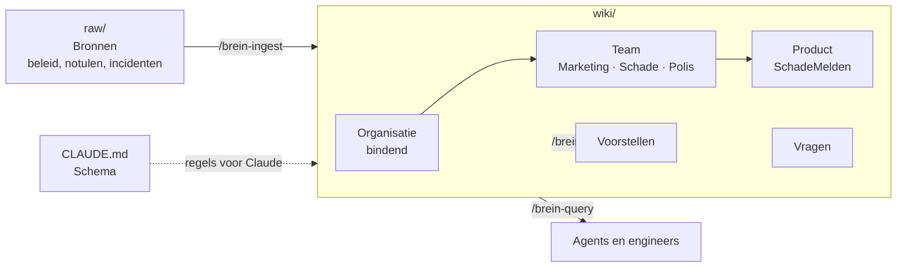

# Gedeeld Brein van Wadlicht Verzekeringen

> Wadlicht Verzekeringen is een **fictief bedrijf** voor demonstraties. Alle namen, regels en cijfers zijn verzonnen.

Het Gedeelde Brein is de kennis waar mensen en agents in de hybride software factory van Wadlicht op bouwen. Het is een LLM-wiki: Claude stelt de kennis één keer samen uit bronnen en houdt haar bij. Mensen beslissen over wat bindend is.

## Beginnen

1. Open deze map (`brein/`) als vault in [Obsidian](https://obsidian.md). De grafiek kleurt per niveau: blauw organisatie, oranje team, groen product, rood voorstel, paars vraag.
2. Lees [[CLAUDE]], het schema: rangorde, statussen, regel-ID's en wat Claude mag.
3. Begin bij de [[index]].

## De drie lagen

| Laag | Map | Wie |
|---|---|---|
| Bronnen | `raw/` | Mensen leggen ze neer, niemand wijzigt ze |
| Wiki | `wiki/` | Claude houdt bij, met bronverwijzing |
| Schema | `CLAUDE.md` | Van mensen |

## Niveaus en rangorde

Organisatie gaat voor team, team voor product. **Een lager niveau mag een regel aanscherpen, nooit versoepelen.**

| Niveau | Wat erin staat |
|---|---|
| Organisatie | [[werkvormen-en-autonomie]], [[privacy-en-bewaartermijnen]], [[informatiebeveiliging]], [[referentiearchitectuur]], [[klantcommunicatie]] |
| Team | [[team-marketing]], [[team-schade]], [[team-polis]] |
| Product | [[schademelden]] |

## Operaties

In Claude Code, vanuit de root van de repository:

| Commando | Wat |
|---|---|
| `/brein-ingest raw/<pad>` | Een nieuwe bron verwerken |
| `/brein-query <vraag>` | Een vraag beantwoorden met regel-ID's |
| `/brein-lint` | Controleren op versoepelingen, veroudering en hiaten |

Elke wijziging van Claude is een diff in git: te reviewen en terug te draaien.
